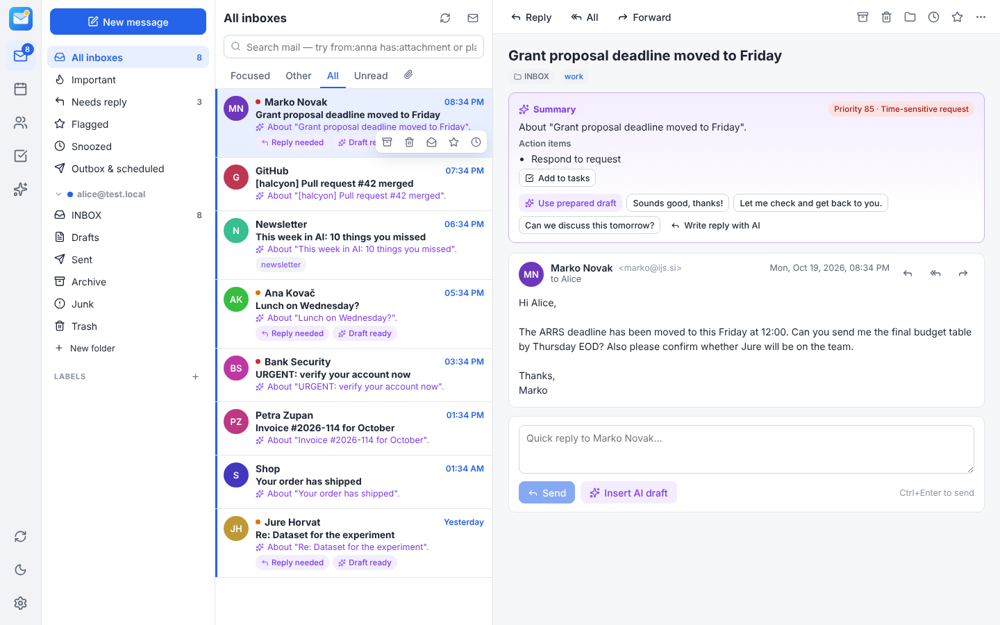

# Halcyon

**AI-native email, calendar and contacts — a self-hostable replacement for Microsoft Outlook.**

Halcyon connects to any number of IMAP/SMTP mailboxes, CalDAV calendars and CardDAV address books, and
puts a language model to work on your mail *in the background*: every new message is triaged, summarised,
prioritised and mined for tasks and events as it arrives, and reply drafts are pre-written for mail that
needs an answer — so when you open a message, the AI work is already done.

It runs three ways from one codebase:

| | |
|---|---|
| **Web app** | Host on an Ubuntu server (systemd + nginx, or Docker). Multi-user. Works in any modern browser, installable as a PWA. |
| **Windows desktop** | Native installer (Electron). Runs fully locally *or* connects to your Halcyon server. Tray, toast notifications, taskbar unread badge, default `mailto:` handler, start at login. |
| **Linux/macOS desktop** | Same desktop app (`AppImage`/`deb`/`dmg` targets). |

AI providers are pluggable per task: **Ollama (self-hosted)**, **OpenAI**, **Anthropic Claude**, **Google Gemini**, and any
**OpenAI-compatible** server (LM Studio, vLLM, llama.cpp, LocalAI, Groq, Mistral, OpenRouter, DeepSeek, …).
A *privacy mode* restricts all AI processing to providers on your own machine/network.

The AI keeps a **memory** of your mail (passage-level semantic index, conversation summaries, events, contacts and
facts it learned or you told it), stored per user in your Halcyon database. **Spaces** such as *Work* and *Private*
let you use everything together or keep it apart — mail accounts, calendars and address books each belong to a
space, and search, the brief and the assistant only see the space you are in.



See [docs/FEATURES.md](docs/FEATURES.md) for the full feature list and a comparison with Outlook, Gmail, Spark and Thunderbird,
and [docs/ARCHITECTURE.md](docs/ARCHITECTURE.md) for how it works.

---

## Quick start (development)

```bash
npm install
npm run build                     # builds the web UI into web/dist
npm start                         # server on http://localhost:8080 (serves the UI too)
# or, with hot reload: npm run dev  (API on :8080, UI on :5173)
```

Open the URL, create the administrator account, then **Settings → Accounts → Add account** and
**Settings → AI → Add provider**.

## Deploy on an Ubuntu server

```bash
git clone <this repo> halcyon && cd halcyon
sudo ./deploy/install-ubuntu.sh --domain mail.example.com --email you@example.com --with-ollama
```

This installs Node.js 22, copies the app to `/opt/halcyon`, builds the UI, writes `/etc/halcyon/halcyon.env`
(with a generated encryption key), installs the `halcyon` systemd service, configures nginx with a
Let's Encrypt certificate and (optionally) installs Ollama with `llama3.1:8b` + `nomic-embed-text`.

- Logs: `journalctl -u halcyon -f`
- Data (SQLite DB, raw messages): `/var/lib/halcyon` — back up together with `/etc/halcyon/halcyon.env`
- Update: `git pull && sudo ./deploy/install-ubuntu.sh --domain …` (idempotent, keeps config and data)

Because mail sync and AI run on the server, insights and drafts keep being prepared while every client is closed.

### Docker

```bash
echo "HALCYON_SECRET=$(openssl rand -base64 32)" > .env
docker compose up -d        # Halcyon on :8080 + Ollama (add provider URL http://ollama:11434)
```

### Podman pod

```bash
./deploy/podman-pod.sh up --with-ollama          # builds the image, creates pod "halcyon" on 127.0.0.1:8080
./deploy/podman-pod.sh systemd                   # optional: start at boot (rootless: loginctl enable-linger $USER)
./deploy/podman-pod.sh update --with-ollama      # after git pull; volumes halcyon-data / ollama-models are kept
```

The first run writes `deploy/halcyon.env` (mode 600, git-ignored) with the generated `HALCYON_SECRET` — back it up
with the `halcyon-data` volume. Ollama runs in the same pod, so add it as provider URL `http://127.0.0.1:11434`
(counts as local for Privacy mode). Options: `--port`, `--bind 0.0.0.0`, `--gpu` (NVIDIA CDI), `--models "…"`.
Put a TLS reverse proxy in front for access from other machines.

## Windows desktop app

Download `Halcyon-Setup-<version>.exe` from the *Desktop builds* workflow artifacts, or build it:

```bash
npm install
npm run dist:win            # → desktop/out/Halcyon-Setup-1.0.0-x64.exe
npm run dist:win-arm64      # → …-arm64.exe for Snapdragon Surface Pro / Copilot+ PCs
```

Building on Windows needs nothing extra; on Linux it needs Wine (`wine64` + `wine32`) for the NSIS step.

The app has two modes (tray menu → **Connection…**); exactly one of them does the sync and AI work, so mail is
never analysed twice:

- **This PC — local AI** (default): mail and AI run on the PC (data in `%APPDATA%\Halcyon`). For on-device AI on a
  Surface / Copilot+ PC install Foundry Local (`winget install Microsoft.FoundryLocal`, then
  `foundry model run phi-4-mini` — it uses the NPU build when available) and use *Settings → AI → Add provider →
  Detect AI on this machine*. Ollama and LM Studio are detected too.
- **Halcyon server**: the app is only a window onto your server; no local server, sync or background AI runs.
  The app checks the server is reachable at start and offers to switch modes if it is not.

Accounts are not shared between modes — add each mail account in one of them only. The installer registers Halcyon as a mail client:
choose it in *Windows Settings → Apps → Default apps → Email* to open `mailto:` links in Halcyon.

The local server only listens on `127.0.0.1` and additionally requires a per-launch secret held by the app,
so other local programs cannot read your mail through it.

## Configuration

Environment variables (see `server/src/config.js`):

| Variable | Default | Meaning |
|---|---|---|
| `HALCYON_PORT` / `HALCYON_HOST` | `8080` / `0.0.0.0` | Listen address |
| `HALCYON_DATA_DIR` | `./data` | Database and message store |
| `HALCYON_SECRET` | generated `secret.key` | Master key for encrypting credentials and API keys (AES-256-GCM) |
| `HALCYON_PUBLIC_URL` | – | External URL (OAuth redirect URIs) |
| `HALCYON_SECURE_COOKIES` | `0` | Set `1` behind HTTPS |
| `HALCYON_TRUST_PROXY` | `127.0.0.1,::1` | Proxies whose `X-Forwarded-*` headers are trusted |
| `HALCYON_ALLOW_SIGNUP` | `0` | Allow self-registration (otherwise the admin creates users) |
| `HALCYON_INITIAL_SYNC_DAYS` | `90` | How far back to download mail on first sync |
| `HALCYON_MAX_INITIAL` | `2000` | Max messages per folder on first sync |
| `HALCYON_POLL_INTERVAL` | `120` | Seconds between full syncs (INBOX uses IMAP IDLE push) |
| `HALCYON_AI_CONCURRENCY` | `4` | Max parallel background AI jobs (server-wide) |
| `GOOGLE_CLIENT_ID/SECRET` | – | Enables "Sign in with Google" (Gmail XOAUTH2, Calendar, Contacts) |
| `MICROSOFT_CLIENT_ID/SECRET`, `MICROSOFT_TENANT` | –, `common` | Enables "Sign in with Microsoft" (Outlook.com / Microsoft 365 IMAP & SMTP) |
| `HALCYON_TLS_INSECURE` | `0` | Accept self-signed IMAP/SMTP certificates (testing only) |

**Gmail / Microsoft 365:** Google requires an *app password* for plain IMAP; Microsoft requires OAuth. Register an
OAuth app (redirect URI `<HALCYON_PUBLIC_URL>/api/oauth/callback`, scopes listed in `server/src/mail/oauth.js`)
and set the client ID/secret to enable the sign-in buttons.

## Choosing AI models

Per-task routing (Settings → AI → Model routing) lets you mix providers, e.g.:

| Task | Runs | Good local choice (Ollama) | Good cloud choice |
|---|---|---|---|
| Background analysis | on every new email | `llama3.1:8b`, `qwen2.5:7b`, `gemma2:9b` | `claude-haiku-5-5`, `gpt-4.1-mini`, `gemini-2.5-flash` |
| Writing | when you compose/rewrite | `qwen2.5:14b`, `llama3.1:8b` | `claude-sonnet-5-5`, `gpt-4.1` |
| Assistant chat | on demand | `qwen2.5:14b` | `claude-sonnet-5-5` |
| Semantic search | every new email | `nomic-embed-text` | `text-embedding-3-small`, `gemini-embedding-001` |

The background queue processes newest mail first, deduplicates work, retries with back-off when a provider is
unreachable, parks jobs until a provider is configured, and reports usage/latency per model in Settings → AI.

## Tests

```bash
sudo ./server/test/setup-dovecot.sh   # throwaway Dovecot IMAP on 127.0.0.1:1143
./server/test/setup-radicale.sh       # optional: throwaway Radicale CalDAV/CardDAV on 127.0.0.1:5232
TEST_DAV_URL=http://127.0.0.1:5232/alice/ npm test   # unit + end-to-end (real IMAP/SMTP/DAV, offline mock AI)
```

The end-to-end suite covers initial sync, threading, HTML sanitising, background AI, search, flag/move/archive/trash
round-trips to the IMAP server, IDLE push and remote changes, sending (incl. Bcc stripping, Sent copy, undo and
scheduled send), replies, calendar invitations with RSVP, recurrence with exceptions, ICS/vCard/CSV import/export,
rules, folder management, credential encryption and two-way CalDAV/CardDAV sync. Provider adapters are tested against fake servers that speak
each vendor's wire protocol, including streaming.

## Project layout

```
server/   Node.js API, IMAP/SMTP sync engine, CalDAV/CardDAV, AI providers + background worker (SQLite)
web/      React single-page app (Vite)
desktop/  Electron shell for Windows/Linux/macOS
deploy/   Ubuntu installer, systemd unit, nginx site
docs/     Features and architecture
```
